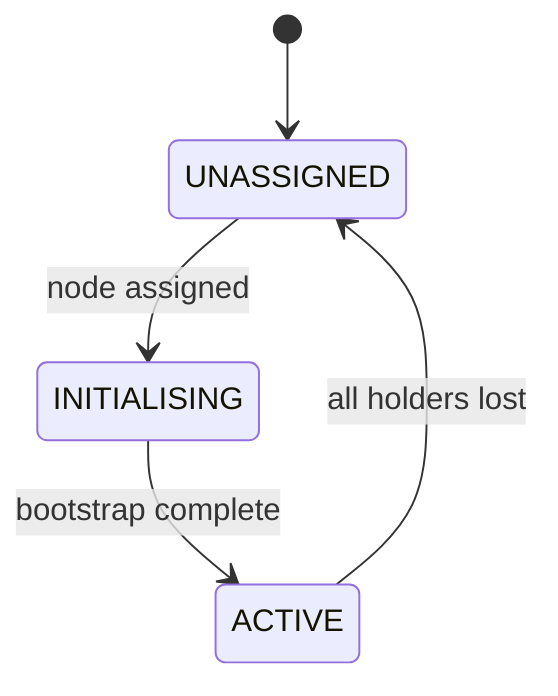
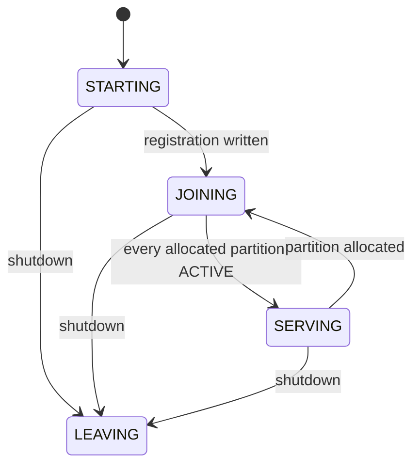

# Narsil Cluster Specification

This document defines cluster formation, node registration, node roles, the partition allocation table, and the partition state machine. It also defines the `ClusterCoordinator` adapter contract.

Structure definitions use a language-neutral notation. `List<T>` is an ordered collection of `T`, `Map<K, V>` a mapping from keys to values, and `T or absent` a value that may be missing; each implementation expresses these in its own type system.

---

## ClusterCoordinator Adapter

The `ClusterCoordinator` adapter covers the coordination backend, which can be etcd, ZooKeeper, Consul, Kubernetes, or any strongly consistent key-value store that supports watches. Every method is asynchronous.

```text
ClusterCoordinator {
  async registerNode(registration: NodeRegistration) -> nothing
  async deregisterNode(nodeId: string) -> nothing
  async listNodes() -> List<NodeRegistration>
  async watchNodes(handler: (event: NodeEvent) -> nothing) -> (() -> nothing)

  async getAllocation(indexName: string) -> AllocationTable or absent
  async putAllocation(indexName: string, table: AllocationTable, expectedVersion: uint64 or absent, writerNodeId: string) -> boolean
  async deleteAllocation(indexName: string) -> nothing
  async watchAllocation(handler: (event: AllocationEvent) -> nothing) -> (() -> nothing)

  async getPartitionState(indexName: string, partitionId: uint32) -> PartitionState
  async putPartitionState(indexName: string, partitionId: uint32, state: PartitionState) -> nothing

  async acquireLease(key: string, nodeId: string, ttlMs: uint32) -> boolean
  async renewLease(key: string, nodeId: string, ttlMs: uint32) -> boolean
  async releaseLease(key: string) -> nothing

  async get(key: string) -> bytes or absent
  async compareAndSet(key: string, expected: bytes or absent, value: bytes) -> boolean
  async delete(key: string) -> nothing

  async getSchema(indexName: string) -> SchemaDefinition or absent
  async putSchema(indexName: string, schema: SchemaDefinition) -> nothing
  async dropSchema(indexName: string) -> nothing
  async listSchemas() -> List<string>
  async watchSchemas(handler: (event: SchemaEvent) -> nothing) -> (() -> nothing)

  async getLeaseHolder(key: string) -> string or absent
  async shutdown() -> nothing
}
```

### registerNode(registration)

- Adds the node to the cluster's node registry.
- The registration must carry a lease-based heartbeat. A node that fails to renew its lease within the TTL loses its registration, and the coordinator emits a `node_left` event.
- Registering an existing `nodeId` again updates that registration, which is what a node does after a restart.

### deregisterNode(nodeId)

- Removes the node from the registry and releases its lease, which fires a `node_left` event for every watcher.
- It is idempotent, so deregistering a node that is not registered is not an error.

### listNodes()

- Returns every node currently registered.

### watchNodes(handler)

- Registers a callback that fires as nodes join and leave. A `node_joined` event follows a new registration, and a `node_left` event follows an expired lease or an explicit deregistration.

### getAllocation(indexName) and putAllocation(indexName, table, expectedVersion, writerNodeId)

- These read and write the allocation table of one index.
- `putAllocation` must be atomic: the whole table is written or nothing is.
- `putAllocation` takes an optimistic concurrency check through `expectedVersion`. With a version supplied, the write succeeds only when the stored table carries that version. With `expectedVersion` absent, the write succeeds only when no table exists for the index yet. It returns true when the write succeeded and false when the check failed.
- That check is what stops a split brain: a controller that has lost its lease cannot overwrite a newer table written by its successor, because the version has already moved on.
- `putAllocation` must also check, in the same atomic operation, that the node named by `writerNodeId` holds the `_narsil/controller` lease, and it must return false where it does not, so that a controller whose lease expired before its next renewal cannot write a table.

### deleteAllocation(indexName)

- Removes the allocation table of one index, which is the last step of the [deletion flow](#index-deletion-flow).
- It is idempotent, so deleting a table that does not exist is not an error.

### watchAllocation(handler)

- Fires whenever any allocation table changes, carrying the index name and the new table.

### acquireLease, renewLease, and releaseLease

- These provide lease-based distributed locking for controller election and per-partition primary assignment.
- `acquireLease` returns true when the lease was taken and false when another node holds it.
- `renewLease` extends the TTL, and returns false when the lease is gone, whether it expired or another node took it.
- `releaseLease` gives the lease up.

### get(key)

- Returns the raw bytes stored under `key` in the coordinator's general key-value store, or absent when the key holds nothing.
- The controller uses it to read index metadata while handling a `schema_created` event; see [Index Metadata](#index-metadata).

### compareAndSet(key, expected, value)

- Sets `key` to `value` and returns true when the current value equals `expected`, and returns false otherwise.
- With `expected` absent, it succeeds only when the key does not exist.

### delete(key)

- Removes `key` from the general key-value store, so that a later `compareAndSet` with `expected` absent can create it again.
- It is idempotent, so deleting a key that holds nothing is not an error.
- A node uses it only for keys that no writer changes after it creates them, such as the [synonym set chunks](#synonym-set-storage), so the delete needs no comparison.

### getSchema, putSchema, dropSchema, listSchemas, and watchSchemas

- Schema metadata is stored in the coordinator, not in the replication log; see [replication.md](replication.md).
- `dropSchema` removes the stored schema and fires a `schema_dropped` event, which starts the [deletion flow](#index-deletion-flow). It is idempotent.
- `listSchemas` returns the name of every stored schema, which is how a newly elected controller finds the indexes it must reconcile.
- `watchSchemas` fires when an index schema is created or dropped, which is how a node discovers a new index and learns that one has gone.

### getLeaseHolder(key)

- Returns the `nodeId` of the node holding the lease at `key`, or absent when no node holds it.
- A primary uses it to find the active controller before it asks to add a replica to the in-sync set or to remove one.
- The value reflects the coordinator's state at the moment of the read, and it can go stale when the lease expires between the read and the use.

### shutdown()

- Deregisters the node, releases every lease, and stops every watcher.
- It must be idempotent.

---

## Event Types

These events reach the watch callbacks.

### NodeEvent

```text
NodeEvent {
  type:         'node_joined' or 'node_left'
  nodeId:       string
  registration: NodeRegistration or absent   (present on node_joined)
}
```

A `node_joined` event follows a new registration, or a re-registration after a restart. A `node_left` event follows an expired lease or an explicit deregistration, and it carries no registration.

### AllocationEvent

```text
AllocationEvent {
  indexName: string
  table:     AllocationTable
}
```

It fires when any field of an index's allocation table changes, whether that is a partition assignment, an in-sync set, a state transition, or a primary term.

### SchemaEvent

```text
SchemaEvent {
  type:      'schema_created' or 'schema_dropped'
  indexName: string
  schema:    SchemaDefinition or absent   (present on schema_created)
}
```

---

## Node Registration

Every node keeps a registration record. The specification fixes its format so that nodes written in different languages can share one cluster.

```text
NodeRegistration {
  nodeId:    string          (unique identifier, such as a UUID v7)
  address:   string          (host and port where the node transport listens)
  roles:     List<string>    ('data', 'coordinator', 'controller')
  capacity: {
    memoryBytes: uint64
    cpuCores:    uint16
    diskBytes:   uint64 or absent
  }
  startedAt: string          (ISO 8601 timestamp)
  version:   string          (specification version, such as '1.0')
  memory: {
    processBytes:      uint64
    processLimitBytes: uint64
    heapBytes:         uint64
    heapLimitBytes:    uint64
    full:              boolean
  } or absent
  partitionBytes: List<IndexPartitionBytes> or absent
  draining:  boolean or absent   (a reader treats an absent value as false)
}

IndexPartitionBytes {
  indexName:  string
  partitions: List<List<uint64>>   (each entry is [partitionId, bytes])
}
```

### nodeId

A unique identifier, recommended as a time-ordered UUID v7. A node with a durability directory must generate its `nodeId` once, store it in that directory, and reuse it on every later start, so that the controller recognises the node's copies after a restart. A node without a durability directory must generate a new `nodeId` on every start. A node must wait for the lease of a live registration under its `nodeId` to expire before it registers.

### address

The network address where this node's transport accepts connections. Other nodes send replication entries and query requests there.

### roles

The roles this node is configured to play; see [Node Roles](#node-roles). A node must carry at least one.

### capacity

The resources the node reports at registration, which the controller reads when it computes assignments. `diskBytes` may be absent, because a browser or in-memory deployment has no disk.

### startedAt

The ISO 8601 timestamp of when the node started. It serves diagnostics, and it breaks a tie during controller election in favour of the node that has been running longest.

### version

The specification version the node follows. Nodes on incompatible versions must not share a cluster, so the controller places no partition on a node whose major version differs from its own, and it treats a version that it cannot parse as a different major version. A node that finds an active controller on a different major version as it joins must fail its start with `NODE_VERSION_INCOMPATIBLE`. A node that finds no active controller joins, and the controller that a later election chooses keeps it out of allocation where the major versions differ.

### memory

The memory that the node uses, which the [Memory Write Block](#memory-write-block) reads. A node that runs where it cannot measure these figures leaves the field absent.

- `processBytes` must be the resident memory of the whole process, because a node can keep vectors and saved segments outside the heap.
- `processLimitBytes` must be the memory limit that a container sets on the process, or the host's total memory where no container sets one.
- `heapBytes` must be the heap that the node's main thread uses, and `heapLimitBytes` the size to which that heap may grow. Both figures must cover the same part of the heap. Where the runtime keeps new objects in a young generation that its collector empties on its own, both figures must leave that generation out. A node runs out of memory when the rest of its heap can't grow, so the garbage in the young generation never causes that failure.
- `full` must hold the value that the [Memory Write Block](#memory-write-block) rules give it.

### partitionBytes

The estimated size in bytes of each partition copy that the node holds, grouped by index. A node may leave a partition out, which keeps the registration within the size limit of the coordinator's requests, and it must then leave out its smallest partitions first.

### draining

A node that an operator removes from the cluster writes its registration again with `draining` set to true, and the controller then moves every copy off that node. A change to `draining` is a topology change, so the controller must run the allocator for it. Four rules govern a drain:

- The controller must place no new copy on a draining node.
- The controller moves each replica on the node as [removingReplicas](#removingreplicas) describes.
- For each partition that the node leads, the controller first gives the lead to an in-sync replica on another node and raises the `primaryTerm`, and it then moves the node's copy in the same way.
- A node that writes `draining` back to false stops the drain, and the controller then treats it as it treats any other node.

### Heartbeat

A node must write its registration again with current `memory` and `partitionBytes` values on every heartbeat, and it must write it at once whenever `full` changes. A change that touches only `memory` and `partitionBytes` is not a topology change, so the controller must not run the allocator for it.

---

## Node Roles

A node plays one or more of three roles, and by default it plays all three.

### data

A data node holds partitions, runs indexing and search locally, and takes part in replication as primary or replica. It runs the full engine in-process: partition management, worker threads, fan-out, and every search and indexing path.

A data node is stateful, so adding or removing one triggers partition reallocation.

### coordinator

A coordinator node receives client queries, reads the allocation table to learn which data nodes hold the relevant partitions, fans the query out over the node transport, and merges the results. It holds no partitions of its own.

A coordinator node is stateless. It caches the allocation table locally, kept current by the allocation watch, so it can be added or removed with no data movement.

A data node that receives a client query acts as coordinator for that request as well as searching its own partitions, so every data node carries the coordinator role for the queries it receives directly.

### controller

A controller node runs the partition allocator, watches membership changes, and writes updated allocation tables to the cluster coordinator. Exactly one controller is active at a time and the rest stand by; election runs through the lease mechanism.

Run an odd number of controller-capable nodes, three by recommendation, so that a lease holder remains available after any single node fails.

A controller handles no data and no queries, and its resource needs are small.

### Default Configuration

With no explicit role configuration, a node plays all three roles, which is the recommendation for a cluster of three nodes or fewer.

Separating the roles pays off as a cluster grows. On a mixed-role node the controller's lease renewal and allocator run compete with query execution, and the coordinator's merging and sorting compete with indexing.

| Cluster size | Recommended topology |
|--------------|----------------------|
| 1 to 3 nodes | Every role on every node |
| 3 to 10 data nodes | Three nodes dedicated to the controller role |
| More than 10 data nodes | Stateless coordinator nodes added behind a load balancer |

---

## Allocation Table

The allocation table maps every partition of an index to its primary node and its replica nodes. The controller writes it to the cluster coordinator whenever the topology changes, whether a node joined, a node left, an index was created, or a partition split.

```text
AllocationTable {
  indexName:         string
  version:           uint64   (increases on every update)
  replicationFactor: uint8    (replicas per partition, the primary excluded)
  assignments:       Map<uint32, PartitionAssignment>
  generation:        string or absent   (the index that serves this name after a partition count change)
  indexUuid:         string or absent   (the identity of the index that this table allocates)
}

PartitionAssignment {
  primary:          string or absent   (nodeId of the primary)
  replicas:         List<string>       (nodeIds of the replica nodes)
  inSyncSet:        List<string>       (nodeIds of the replicas fully caught up)
  removingReplicas: List<string>       (nodeIds that a move takes the partition off, or absent)
  lastHolders:      List<string>       (nodeIds that still hold a copy of an unserved partition, or absent)
  state:            PartitionState
  primaryTerm:      uint64             (the current term, raised on failover)
  commitPoint:      uint64             (a floor on the seqNo acknowledged to a client)
  unassignedReason: UnassignedReason or absent
}
```

### version

A counter that increases on every update. A node compares its cached version with the coordinator's to spot stale state, and it rejects an operation tagged with a version below its own.

### indexUuid

The `indexUuid` that the index metadata holds when the controller writes the table. The controller must copy it into every table it writes for the index, except the empty table that a drop writes, which carries the `indexUuid` of the table it replaces, because the drop clears the metadata first. A node that holds a table for a name and receives another for that name must take the received table where both carry an `indexUuid` and the two differ, whatever their versions, because the name now belongs to another index. Otherwise it must keep the table with the higher version. A table written by a release that predates the field carries none. A controller that reads a table whose `indexUuid` differs from the one the index metadata holds must not write that table back with any change; it must treat the index as having no table, so that it never gives one index's copies to another index of the same name.

### replicationFactor

The number of replicas per partition, not counting the primary, so a factor of 2 gives one primary and two replicas, three copies in total. The default is 1, which is two copies.

It is set per index at creation time, and changing it on an existing index triggers reallocation.

### generation

The name of the index that serves this index name, which the controller writes when a [partition count change](#partition-count-change) finishes. A table that carries `generation` holds no assignments. Every reader must resolve the index name to that generation before it routes a read, a write, or a metadata lookup. A listing reports the index name and leaves out every name that starts with `narsil-generation-`. A table with no assignments and no `generation` still counts as absent, as the [deletion flow](#index-deletion-flow) requires.

### assignments

A map from partition ID to its assignment, with an entry for every partition in the index. A partition with no live primary has an absent `primary` and the state `UNASSIGNED`.

### removingReplicas

The nodes named here hold a copy that the controller is moving to another node, and a partition with no move under way leaves the field absent. A move adds the target node to `replicas` and the source node to `removingReplicas` in one table write, so that the partition keeps every copy that it held while the new copy catches up. Five rules govern a move:

- A replica in `removingReplicas` stays in `replicas` and in `inSyncSet`, and its primary must send it every entry until the controller removes it.
- Once the partition holds `replicationFactor` in-sync replicas outside the field, the controller removes each node that the field holds from `replicas` and from `inSyncSet`, and it removes the field.
- Where `replicas` holds fewer than `replicationFactor` nodes outside the field, because the target of the move left the cluster, the controller removes the field, which cancels the move. A later allocator run may then start another move.
- The controller must start no second move on a partition while the field is present.
- The controller must promote a replica in `removingReplicas` only where the in-sync set holds no other candidate.

A move leaves the partition in `ACTIVE`, because the state covers every copy of the partition while a move changes one copy.

### lastHolders

The nodes named here still hold a copy of a partition no node serves, and a served partition leaves the field absent. The controller writes the failed primary and the replicas that were in sync with it into this field as it moves the partition to `UNASSIGNED`, because those nodes hold every write the cluster acknowledged for the partition. A promotion leaves the field as it stands, so that a promoted node that fails before the partition reaches `ACTIVE` leaves the other holders on record. The controller adds the failed primary to the field on each further failure, and it clears the field as it moves the partition to `ACTIVE`. A node this field names must keep its copy until the controller clears the field, and [No Eligible Replica](replication.md#no-eligible-replica) governs how the controller gives the partition back to one of them.

A partition that fails before it first reaches `ACTIVE` gets no `lastHolders`, as [No Eligible Replica](replication.md#no-eligible-replica) describes.

### unassignedReason

The controller writes this field whenever a partition stays `UNASSIGNED` after it asks the partition's last holders for a copy. It writes one of four values:

```text
UnassignedReason = 'HOLDER_OFFLINE'
                 | 'HOLDER_UNREACHABLE'
                 | 'HOLDER_IDENTITY_MISMATCH'
                 | 'HOLDER_WITHOUT_DATA'
```

| Reason | Meaning |
|--------|---------|
| `HOLDER_OFFLINE` | A node `lastHolders` names is absent from the coordinator's registrations, so the controller waits for it to return. |
| `HOLDER_UNREACHABLE` | A registered holder left [cluster.partition_stores](transport.md#clusterpartition_stores) unanswered, or it answered with a payload the controller could not read. |
| `HOLDER_IDENTITY_MISMATCH` | A holder answered under an `indexUuid` that differs from the one the coordinator holds, so that copy holds the documents of an earlier index of the same name, or the holder keeps no copy of that name at all. |
| `HOLDER_WITHOUT_DATA` | Every holder answered under the coordinator's `indexUuid` with a list that left the partition out. |

The controller writes the first value that applies in the order above, so a partition that may still come back never reports a reason that rules recovery out. It repeats the enquiry whenever a node registers. It sets no limit on the number of attempts, because a holder may return at any time. It removes the field when it moves the partition out of `UNASSIGNED`. A partition that reaches `UNASSIGNED` at index creation leaves the field absent, because the controller asks no node about a partition that never held a document.

---

## Partition State Machine

Every partition moves through a fixed set of states. The controller owns those transitions and writes each one to the cluster coordinator.

```text
PartitionState = 'UNASSIGNED'
               | 'INITIALISING'
               | 'ACTIVE'
               | 'MIGRATING'
               | 'DECOMMISSIONING'
```



| State | Meaning |
|-------|---------|
| `UNASSIGNED` | No node holds this partition, which happens when an index is first created and when the primary and every replica are lost. |
| `INITIALISING` | A node is bootstrapping the partition, by incremental catch-up or by snapshot transfer. It serves no reads and accepts no writes while it does. |
| `ACTIVE` | The partition is fully operational. The primary accepts writes and serves reads, and each replica serves reads and receives replication entries. |
| `MIGRATING` | Reserved. The controller writes no partition in this state, and a reader must accept it. |
| `DECOMMISSIONING` | Reserved. The controller writes no partition in this state, and a reader must accept it. |

Three rules govern the transitions:

- Only the controller may move a partition between states.
- A partition in `INITIALISING` moves to `ACTIVE` when the assigned node reports that bootstrapping finished.
- A partition stays in `ACTIVE` while the controller moves one of its copies, whether for balance, after a node failure, or off a draining node, and [removingReplicas](#removingreplicas) records the move.

A partition whose holders have all failed returns to `UNASSIGNED`.

---

## Node Readiness

A node reports one readiness state, which tells a client whether the node serves work.

```text
NodeReadiness = 'STARTING'
              | 'JOINING'
              | 'SERVING'
              | 'LEAVING'
```



| State | Meaning |
|-------|---------|
| `STARTING` | The node has settled every local copy against the coordinator and holds no registration yet. |
| `JOINING` | The node holds a registration and bootstraps the partitions the controller allocated to it. |
| `SERVING` | The node holds a registration and serves every partition the controller allocated to it. |
| `LEAVING` | The node has begun shutting down, so it takes no further work. |

Three rules govern what a node serves:

- A node must route every read and every write for an index through the allocation table the coordinator holds for it.
- A node must refuse a read or a write with `QUERY_ROUTING_FAILED` while the coordinator holds metadata for the index and holds no allocation table for it.
- A node may serve an index the coordinator holds no metadata for from its own copy, which is how a purely local index stays readable on a cluster node.

---

## Memory Write Block

A node sets `full` in its registration once either memory figure passes the block fraction of its limit, and it clears `full` once both figures fall below the resume fraction:

```text
when not full and (processBytes > blockFraction * processLimitBytes
                   or heapBytes > blockFraction * heapLimitBytes):
  full = true
when full and processBytes < resumeFraction * processLimitBytes
          and heapBytes < resumeFraction * heapLimitBytes:
  full = false
```

The block fraction is 0.9 and the resume fraction is 0.8 by default. An implementation must let each node set both, and it must accept only a resume fraction that is above 0 and below a block fraction of at most 1. A node should measure its memory at least once a second, because a node that measures it only on each heartbeat can run out of memory between two heartbeats.

Some runtimes stop a process when its heap holds more than a fixed fraction of the heap limit and the process spends most of its time collecting garbage. V8 stops the process after four full collections in a row that each leave the old generation holding at least 0.8 of its limit while collection takes more than 60% of the time. A full node holds its heap near the block fraction until it clears `full`, so on such a runtime a node must compare `heapBytes` with a block fraction and a resume fraction that both stay below that fixed fraction, whatever its settings say. The node must leave room below the fixed fraction for the memory that it admits between two measurements. A node keeps the settings that it is given for `processBytes`, because the process limit carries no such rule. An implementation must document the heap fractions that it uses on each runtime.

A node must also set `full` when it refuses an insert or an update because its bound on the memory that the write needs, added to its latest measurement, passes the block fraction of either limit. That bound covers the request that carries the write as well as the indexing. The rule applies only when the node collected garbage and measured again for that refusal, and only when either figure of the new measurement is at or above the resume fraction of its limit. Without it, a node that refuses every write that it receives can stay just below the block fraction, so the other nodes keep sending it writes. A node that holds little data measures below the resume fraction, so a single write that is larger than its free memory leaves its `full` value unchanged. The node clears `full` under the rule above.

Six rules govern the block:

- A node must refuse an insert or an update with `CLUSTER_WRITE_BLOCKED` while any node that the index's allocation table names as a primary or a replica reports `full`.
- A node must refuse the whole of a batch insert or a batch update to a blocked index.
- A primary must refuse a forwarded insert or update to a blocked index as well, so that a write which another node forwarded before it learnt of the block still meets it.
- A node must accept removes, searches, and document reads to a blocked index, so that an operator can free memory by removing documents.
- A node must judge its own `full` value from its latest measurement, and it may judge every other node's from the latest registration that it has received for that node.
- A replica must apply every replicated entry whatever its own `full` value, because a refused entry would leave the copies of a partition holding different documents.

The block lifts once no node that holds a copy of the index reports `full`.

A node may still refuse a remove, a search, or a document read when the memory that reading the request takes, added to its latest measurement, would pass 0.95 of either limit, because the node would otherwise run out of memory while it reads the request. The node adds the bytes in use in a young generation to its heap figure for that check, as it does for an insert or an update. The node must refuse such a request with an error that tells the client to retry it.

A node may also refuse a search, a document read, or a list of documents when the memory that building one part of its answer takes, added to its latest measurement, would pass 0.95 of either limit. For that check, the node must count its old generation by the bytes that V8 has committed to it, meaning the `space_size` that `v8.getHeapSpaceStatistics()` reports for every space outside the young generation, because V8 stops the process once those committed bytes pass `--max-old-space-size`, and fragmentation can hold them about a fifth above the bytes in use. The node must refuse such a request before it sends any part of the answer, with HTTP status 429, the code `TOO_MANY_REQUESTS`, and `response_would_fill_memory` in `details.reason`, so that the client can retry it.

A node must also bound the bytes of the inserts and updates in progress on it, because a burst of writes can exhaust the node's memory between two of its measurements:

```text
when inFlightBytes > 0 and inFlightBytes + requestBytes > inFlightFraction * heapLimitBytes:
  refuse the write with CLUSTER_WRITE_BLOCKED
```

A node must accept a write that arrives while no other insert or update is in progress, whatever its `requestBytes`. A client retries a write after this refusal, so if an idle node refuses a write that is larger than the bound, the client will retry it forever. The memory rule below applies to that write as it does to every other.

`requestBytes` is the node's estimate of the bytes in the documents of the write. That estimate must rise with the length of every string and binary value in those documents, including the fields of a partial update. `inFlightBytes` is the sum of `requestBytes` over every insert and update that is in progress on the node, from the moment that the node accepts it until it completes, whether a client sends it to the node or another node forwards it there. A node that receives a write from a client and holds the primary for it must count that write once. The in-flight fraction is 0.02 by default. An implementation must let each node set it to any value above 0 and at most 1. A node must leave removes and replicated entries out of `inFlightBytes` and accept them whatever the value of `inFlightBytes`.

A node must also refuse an insert or an update when the memory in use plus the memory that indexing can take would pass the block fraction of either limit. Indexing a document can take many times the document's own bytes, while the node's measurement shows only the memory in use before the write starts:

```text
when heapBytes + projectedBytes > blockFraction * heapLimitBytes
  or processBytes + projectedBytes > blockFraction * processLimitBytes:
  refuse the write with CLUSTER_WRITE_BLOCKED
```

`heapBytes` and `processBytes` come from the node's latest measurement. `projectedBytes` is the node's bound on the memory that indexing the next documents can take, added to the same bound for every other group of documents that the node is indexing or that it finished after that measurement. A node must keep counting finished documents until its next measurement, because the memory that they leave behind shows only in a measurement that the node takes after they finish.

Where `heapBytes` leaves out a young generation, a node must add the bytes that are in use in that generation to `projectedBytes` when it compares the sum with `heapLimitBytes`. The young generation can hold every document that the node indexed since the collector last emptied it. When the collector next empties it, the collector moves the live part into the rest of the heap, so a measurement of the rest of the heap can miss all of those documents. The comparison with `processLimitBytes` leaves those bytes out, because `processBytes` already counts them.

An implementation must compute the bound from each document without analysing its text, so that the check adds no work to indexing. The bound must never fall below the memory that indexing the document can take, for every language and tokeniser that the index uses, and it must hold for any document that a client can choose, because a client chooses what it sends. An implementation must therefore derive it from the most terms that one character can produce under each field's analysis, multiplied by the memory that its engine spends on one distinct term, and it must document both figures. Where an implementation has no such limit for a field, as with a custom tokeniser, it must count the terms that the field's tokeniser produces before it admits the document.

A node must index a batch in groups whose bounds fit under the block fraction, and it must measure its memory before each group. When the node cannot fit even the next document of a batch under the block fraction, it must refuse that document and every later document of the batch, each with `CLUSTER_WRITE_BLOCKED` among the batch's failures, while it keeps every document that it has already indexed. A node refuses a batch whole under the block because it knows before the batch starts that it is full, while here it learns part of the way through the batch that its memory is running short. A node must refuse a document whose own bound passes the block fraction of its heap limit whatever memory it holds, because that document cannot fit even on an idle node.

A node may collect garbage and measure again before it refuses a document, but it must limit how often it collects garbage for that purpose, because a client can otherwise force a collection with every write that it sends. A node must leave removes and replicated entries out of `projectedBytes` and accept them whatever its value.

The details of a `CLUSTER_WRITE_BLOCKED` refusal must hold a `reason`, which is `node_memory_full` under the block, `write_bytes_in_flight` under the bound on writes in progress, `write_would_fill_memory` where the bound of a document would pass the block fraction, `write_exceeds_memory` where a document cannot fit even on an idle node, and `settings_contention` when a [synonym set replacement](#synonym-set-replacement-flow) runs out of retries.

---

## Controller Election

Exactly one controller is active at a time, elected by acquiring a lease on the well-known key `_narsil/controller`.

```text
1. On startup, a controller-capable node calls
   acquireLease('_narsil/controller', nodeId, ttlMs).

2. When it takes the lease:
     it becomes the active controller
     it starts watching membership and allocation events
     it renews the lease periodically, recommended at ttlMs / 3

3. When it does not take the lease:
     it becomes a standby controller
     it retries acquireLease periodically

4. When a renewal fails, because the node was cut off or ran slow:
     it must stop every controller operation at once
     it returns to standby and retries acquireLease
```

The active controller does five things: it watches node join and leave events, runs the partition allocator whenever the topology changes, writes the new allocation table through `putAllocation`, drives partition state transitions, and elects a new primary per partition when one dies by promoting a replica from the in-sync set. The promotion rules are in [Failover](replication.md#failover).

---

## Partition Allocator

The allocator computes an allocation table from the current cluster state, and it runs on the controller whenever the topology changes. It is a pure function of its inputs.

```text
allocate(
  nodes:             List<NodeRegistration>
  currentTable:      AllocationTable or absent
  indexName:         string
  partitionCount:    uint32
  replicationFactor: uint8
  constraints:       AllocationConstraints
) -> AllocationTable
```

With `currentTable` absent, meaning a new index, the allocator uses `partitionCount` to create assignments for partitions 0 through `partitionCount - 1`. With a table present, meaning a topology change, it keeps the existing partition set and rebalances the assignments across the updated node list.

The allocator must satisfy five constraints:

- **No co-location.** A partition's primary and its replicas are on different nodes.
- **Capacity awareness.** No node receives a partition copy that would carry its held bytes past `capacity.memoryBytes`, and no node that reports `full` receives a new copy.
- **Balance.** Partitions spread as evenly as node capacity allows.
- **Minimal movement.** A recomputation after a topology change moves as few partitions as it can, because stability beats perfect balance.
- **Zone awareness**, optional. When nodes report zone or rack metadata, replicas spread across zones.

```text
AllocationConstraints {
  zoneAwareness:    boolean          (default false)
  zoneAttribute:    string           (the capacity key naming the zone, default 'zone')
  maxShardsPerNode: uint32 or absent (an optional upper bound)
}
```

The allocator must size a partition by the largest `bytes` value that any node reports for it in `partitionBytes`, and it must count a partition that no node reports as 52,428,800 bytes. A node's held bytes are the sum of every size that it reports, plus the size of each copy that the table assigns to it and that it leaves out of its report.

The heuristic itself is implementation-defined. This specification fixes the inputs, the outputs, and the constraints, and leaves the choice open between rendezvous hashing, consistent hashing with bounded loads, a greedy weight-based balancer, and constraint-solver placement. Whichever an implementation picks must satisfy the constraints above and produce identical output for identical input.

---

## Index Metadata

The node that creates an index in cluster mode stores the index metadata in the coordinator, so that the controller can compute the first allocation from it and every node can build its copy of the index from it.

```text
IndexMetadata {
  indexUuid:         string          (unique identifier, such as a UUID v7)
  partitionCount:    uint32
  replicationFactor: uint8
  constraints:       AllocationConstraints
  settings:          IndexSettings   (optional)
}

IndexSettings {
  language:          string
  tokenizer:         string                       (optional; the registered tokeniser name)
  stopWords:         string                       (optional; the registered stop word set name)
  stopWordList:      List<string>                 (optional; the words of a literal stop word set)
  bm25:              { k1: float32, b: float32 }  (optional; each key optional)
  surfaceForms:      boolean                      (a reader treats an absent value as true)
  defaultScoring:    string                       (optional; "local", "dfs", or "broadcast")
  trackPositions:    boolean                      (optional)
  strict:            boolean                      (optional)
  required:          List<string>                 (optional; field paths every document must supply)
  vectorPromotion:   VectorSnapshotPromotion      (optional)
  patternValueLimit: uint32                       (optional; the most code points a pattern field value may hold)
  partitionConfig:   PartitionSnapshotLimits      (optional; maxDocsPerPartition and watermark alone)
  embedding:         EmbeddingSnapshotConfig      (optional)
  synonyms:          SynonymSetRef                (optional; where the coordinator holds the synonym set)
}

SynonymSetRef {
  generation: string   (unique identifier of this stored copy, such as a UUID v7)
  digest:     string   (lowercase hexadecimal SHA-256 of the encoded set)
  chunkCount: uint32
  byteLength: uint32
}
```

The creating node generates the `indexUuid`, which identifies the index for as long as the index exists. When a node creates an index under the name of a dropped one, it generates a new `indexUuid`, so the two indexes stay distinct although they share a name. A node must compare the value with the one that it persisted before it adopts a local copy; see [Joining the Cluster](#joining-the-cluster).

The creating node writes its index configuration into `settings`, so that every node builds its copy of the index with the same configuration. Each key of `IndexSettings` has the type, the meaning, and the default of the key of the same name in the [index configuration payload](../envelope.md#index-configuration-payload), except `synonyms`, which references the set that [Synonym Set Storage](#synonym-set-storage) defines, because a set can outgrow one coordinator value. Six rules govern the settings:

- The creating node must write `language` in every case, while it must write each other key only when the index configuration sets that option.
- The creating node must leave `maxPartitions` out of `partitionConfig`, because `partitionCount` sets the number of partitions. [Capacity in a Cluster](../partitioning.md#capacity-in-a-cluster) defines how each node enforces the other two limits.
- The creating node must fail the create request with `CONFIG_INVALID` when the index configuration gives the tokeniser or the embedding adapter as an instance, or the stop words as a function, because a node cannot serialise code into the metadata.
- Every node that creates a copy of the index, the creating node included, must create it with the stored schema and every key of `settings`, so that a replica applies each write exactly as its primary does.
- A node other than the creating node must still create its copy when it has no embedding adapter for the index, treating the missing adapter as recovery does in [Index Metadata](../durability.md#index-metadata).
- When `settings` is absent, a node must create its copy from the stored schema, with every option at its default except the language, which the node may take from a snapshot archive that it restores.

The creating node serialises the record as MessagePack and stores it in the coordinator's general key-value store under a well-known key:

```text
_narsil/index/{indexName}/config
```

### Synonym Set Storage

The encoded set is the MessagePack encoding of the `List<SynonymRule>` that the caller wrote, as [Synonyms](../algorithms.md#synonyms) defines. A node must split the encoded set, in order, into chunks of at most 1,048,576 bytes, so that each write stays inside the request size that etcd accepts by default. It must store chunk `i` under `_narsil/synonyms/{indexUuid}/{generation}/{i}` with `compareAndSet(key, absent, chunk)`, so that no writer can change a stored chunk. Every stored copy takes a fresh `generation`, so that a node that deletes a replaced copy can never delete a copy that another node stored.

A node that reads the set must join the chunks in order. Where a chunk is absent, the node must read the index metadata again, because a replacement can delete the chunks of the copy that the node read first. It must raise `CONTROLLER_METADATA_INVALID` where the metadata still references that generation, where the joined bytes disagree with `byteLength` or `digest`, or where the set breaks the shape or the limits in [Synonyms](../algorithms.md#synonyms), as it rejects any other malformed key of `settings`.

### Index Creation Flow

```text
1. The node that receives the create request:
   a. generates a fresh indexUuid
   b. builds the settings from the index configuration
   c. stores the chunks of the synonym set under a fresh generation,
      as Synonym Set Storage defines, when the configuration holds
      a non-empty set
   d. writes the index metadata with
      compareAndSet('_narsil/index/{indexName}/config', absent, bytes),
      so that a second creation under the same name fails, and
      deletes the chunks from step c when that compareAndSet fails
   e. writes the schema with putSchema(indexName, schema), which
      fires a schema_created event

2. The controller receives that event through watchSchemas:
   a. it reads the metadata with
      get('_narsil/index/{indexName}/config')
   b. it calls allocate with the partitionCount, the
      replicationFactor, and the constraints from the metadata
   c. it writes the first allocation table with putAllocation

3. When a creating node crashes between steps 1d and 1e, its
   metadata stays orphaned, because the controller allocates an
   index only after its schema_created event. The next create call
   for the same name fails its compareAndSet on the existing key,
   so the caller can retry the creation or clean up the partial
   one.

4. A controller that crashes between steps 2a and 2c leaves a
   schema with no allocation. When listSchemas returns that schema
   and getAllocation returns no table for it, the next controller
   calls allocate and writes the first allocation table with
   putAllocation.
```

A node that receives a create request while it holds a local copy under the same name, whose index metadata is empty because a drop removed it, waits up to 30,000 ms for step 3 of the [deletion flow](#index-deletion-flow) to remove that copy before it creates the index. The node never deletes the copy itself, because a copy whose metadata is absent may be the only one left, as [Joining the Cluster](#joining-the-cluster) describes.

A caller changes the `partitionCount` of an index through the [partition count change](#partition-count-change), which keeps reads and writes open until a cutover of a few seconds at most. Every node must create its local index with exactly `partitionCount` partitions, so that any holder can load a serialised partition unchanged.

After creation, a caller can change an index's `replicationFactor` by sending [cluster.replication_factor](transport.md#clusterreplication_factor) to the controller. The controller stores the new factor in the index metadata, then writes an allocation table that carries it, and it applies the factor at once. A higher factor fills the new replica slots, and each new copy bootstraps. A lower factor removes the surplus replicas, taking any lagging replica first and then the copy on the busiest node, and it never removes the primary. The index metadata holds the factor that counts, so the controller must take the factor from the metadata on every allocator run, which lets a controller elected after a crash between the two writes finish the change.

A caller rebuilds the terms of a cluster index through any node, which sends [cluster.rebuild_analysis](transport.md#clusterrebuild_analysis) to every node that holds a copy of the index. Each node rebuilds every copy that it holds from that copy's own documents, as a single engine rebuilds an index, and it builds each copy with the settings in the index metadata, so a primary and its replicas reach the same terms without sending entries. A node skips a copy whose recorded analysis revision already matches the revision of the language module, so a repeated call rebuilds only the copies that are still stale. The node that received the call reports success once every holder answers. It fails the call with `QUERY_PARTIAL_FAILURE`, naming each node that answered with an error, that the transport could not reach, or that left the cluster before it answered.

### Partition Count Change

A caller changes the `partitionCount` of an index by sending [cluster.rebalance](transport.md#clusterrebalance) to the controller. The controller builds the new layout as a hidden generation of the index, copies every document into it while the current generation goes on serving, and moves the index name onto the generation once the copy has caught up, as Vitess switches traffic after it reshards. A forwarded document carries its vector values, so the generation stores them without calling an embedding adapter.

```text
1. The controller records the change under
   _narsil/index/{indexName}/rebalance with compareAndSet against
   an absent value, so that a second change to the same index fails
   with PARTITION_REBALANCING_BACKPRESSURE while the first one runs.
2. It creates the generation as an ordinary index named
   narsil-generation-{indexUuid}, with a fresh indexUuid, the stored
   schema and settings, the new partitionCount, and the current
   replicationFactor, and it allocates that index through the
   creation flow.
3. Once every partition of the generation is ACTIVE, the controller
   sends cluster.reshard_start to the primary of each partition of
   the current generation. That primary takes a snapshot of its
   partition at its last sequence number S, records S under
   _narsil/index/{indexName}/rebalance/{partitionId}, and sends
   every document in the snapshot through cluster.reshard_forward,
   routed by the new partitionCount.
4. The primary then reads its replication log from S + 1 in
   sequence order and forwards each entry as the full document that
   the entry left, or as a removal. After each batch that the
   generation acknowledges, it records the highest forwarded
   sequence number under the same key, together with the last
   sequence number in its log at that moment.
5. Once the recorded forwarded sequence number of every partition
   is within 1,000 entries of its recorded last sequence number, the controller sets the phase of the
   record to cutover and sends cluster.reshard_cutover with block to
   each primary of the current generation. Each of those primaries
   refuses every new write with PARTITION_REBALANCING_BACKPRESSURE,
   waits for the writes that it has already accepted, and answers
   with its last sequence number.
6. Once each recorded forwarded sequence number reaches the one
   that its primary answered, the controller writes the allocation
   table of the index name with generation set to the generation's
   name and no assignments, using the version of the stored table
   as the expected version. That one write moves every read and
   write onto the generation.
7. The current generation then goes through the deletion flow. The
   controller keeps the schema and the index metadata stored under
   the index name, so that the name stays taken, and it deletes the
   record.
```

Six rules keep the copy exact through faults:

- A forwarded document replaces the stored document where one exists, and the generation inserts it otherwise. A forwarded removal succeeds where the document is already absent, so a primary can resend any entry. Each document lives in one partition of the current generation, so forwarding each partition in sequence order keeps the order of every write to a document.
- Each forwarded batch carries the primaryTerm of the partition that sent it. A primary of the generation must refuse a batch whose term is lower than the highest that it has accepted for that change and that partition, and a write of the progress key that carries a lower term must fail, so that a demoted primary can neither overwrite newer documents nor move the recorded position back.
- When the controller promotes a new primary for a partition of the current generation, it sends cluster.reshard_start to that primary, which resumes after the recorded sequence number. Where the log of that primary no longer holds the next entry, the primary sends cluster.reshard_purge to every primary of the generation, which removes every document that routes to that partition under the current `partitionCount`, and it restarts from a new snapshot once they all answer, so that no document that a removal deleted in the gap survives.
- A primary of the current generation keeps refusing writes with `PARTITION_REBALANCING_BACKPRESSURE` from the cutover block until its copy is dropped, and a primary that the controller promotes while the phase is `cutover` must refuse writes in the same way, so that a router with a stale table retries until its allocation watch delivers the swap.
- Where the catch-up in step 6 takes longer than 10,000 ms, the controller sends cluster.reshard_cutover with lift, sets the phase back to `copying`, and tries again. After 10 cutover attempts, it aborts the change.
- An abort, and any failure before the swap, sets the phase to `aborting`, drops the generation through the deletion flow, deletes the record, and lifts the block, so the current generation keeps serving. A newly elected controller reads the record and resumes: in the `copying` phase it sends cluster.reshard_start again, in the `cutover` phase it sends lift and returns to `copying`, and in the `aborting` phase it finishes the drop.

The controller stores the record and each partition's progress as MessagePack in the coordinator's general key-value store:

```text
_narsil/index/{indexName}/rebalance
RebalanceRecord {
  jobId:                string   (a UUID v7 for this change)
  sourceGeneration:     string   (the index that serves the name now)
  targetGeneration:     string   (narsil-generation-{indexUuid})
  targetPartitionCount: uint32
  phase:                'copying' or 'cutover' or 'aborting'
  cutoverAttempts:      uint32
}

_narsil/index/{indexName}/rebalance/{partitionId}
RebalanceProgress {
  jobId:          string
  primaryTerm:    uint64   (the term of the primary that wrote this record)
  snapshotSeqNo:  uint64
  forwardedSeqNo: uint64
  sourceLastSeqNo: uint64  (the last sequence number in the primary's log when it wrote this record)
}
```

The controller creates the record with compareAndSet against an absent value and deletes it, with every progress key, once the swap or the abort finishes. The primary of each partition writes its progress key with compareAndSet. The generation keeps its own config, schema, and allocation keys under its own name.

The node that received the call waits until the allocation table of the index name carries the generation that the record names, and it fails the call with `ALLOCATION_FAILED` where the record is deleted first. A node must refuse to create an index whose name starts with `narsil-generation-` through any operation that a caller can reach, failing with `CONFIG_INVALID`.

### Index Deletion Flow

Deleting an index reverses the creation flow, and the controller drives the teardown so that every holder learns of it through the allocation watch it already runs.

```text
1. The node receiving the drop request:
   a. clears the index metadata with
      compareAndSet('_narsil/index/{indexName}/config', current, empty)
   b. deletes each chunk of the synonym set that the cleared metadata
      referenced, with delete(key)
   c. drops the schema with dropSchema(indexName), which fires a
      schema_dropped event

2. The controller observes that event:
   a. it writes an allocation table with no assignments through
      putAllocation, using the stored table's version as the
      expected version
   b. it deletes the table with deleteAllocation

3. Every node observes the empty table through its allocation
   watch, drops each partition that it held, and drops its local
   copy of the index once it holds no partition of that index. It
   drops a copy that never held a partition in the same way, such
   as the copy that a node makes when it receives the create
   request.

4. The node that received the drop request answers it once
   getAllocation returns no table for the index, or a table whose
   `indexUuid` differs from the dropped index's, its own copy is
   gone, and every registered data node answers
   cluster.partition_stores with no copy under the dropped
   indexUuid. When those three conditions do not all hold within
   30,000 ms, it raises QUERY_NODE_TIMEOUT naming the nodes that
   still hold a copy, and the drop stands. A drop of the same name
   that the caller retries after that error waits for the same
   three conditions.

5. A controller that crashes between steps 2a and 2b leaves an
   empty table behind. Every reader must treat an allocation table
   with no assignments as absent, so the next create call for the
   same name allocates afresh and the empty table is overwritten.

6. An empty metadata value under the index config key counts as
   absent, so the next create call for the same name may replace
   it with fresh metadata. A non-empty value still blocks the
   create, exactly as the creation flow describes.

7. A node that stays offline for the whole teardown keeps its
   local copy, because it observes no allocation change while it
   is gone. It finds that copy orphaned when it rejoins; see
   [Joining the Cluster](#joining-the-cluster).
```

A drop of an index name whose table carries a `generation` drops that generation through the same flow, and a drop during a partition count change aborts the change first.

A drop is not atomic across nodes: a query routed while the teardown runs can reach a node that already dropped its partitions, and the coordinator then reports the failure through the partial-results rules in [query-routing.md](query-routing.md#partial-results).

### Synonym Set Replacement Flow

```text
1. The node that receives the replace request:
   a. raises CONFIG_INVALID for a set that breaks Synonyms in
      algorithms.md, analysing each word with the index's analysis
   b. reads the metadata with get('_narsil/index/{indexName}/config'),
      and raises INDEX_NOT_FOUND where the value is absent, empty,
      or holds another indexUuid, after it deletes any chunks that
      it stored in step c
   c. stores the chunks of a non-empty set under a fresh generation,
      once for the whole request
   d. writes the metadata, with settings.synonyms set to the new
      reference or left out for an empty set, through
      compareAndSet('_narsil/index/{indexName}/config', current, bytes)
   e. returns to step b when that compareAndSet fails, until its
      retry budget runs out, and then deletes its chunks and raises
      CLUSTER_WRITE_BLOCKED with the reason settings_contention
   f. deletes each chunk of the generation that the replaced
      metadata referenced, once the compareAndSet succeeds
   g. sends cluster.index_settings to every node that the allocation
      table assigns a partition of the index, and returns once each
      of them answers; a node that gives no answer within the
      transport timeout makes the request fail with
      QUERY_NODE_TIMEOUT, while the stored set stays in place

2. A node that receives cluster.index_settings reads the metadata
   and the set again, applies the stored set to its copy and to
   every worker copy, and then answers.

3. A node that misses the message applies the stored set when it
   adopts its copy, as step 3a of Joining the Cluster describes.
```

The last replacement to write its metadata wins, because each node retries with its own set after another write changes the metadata. A replacement that fails with `QUERY_NODE_TIMEOUT` keeps the new set stored, so a retry of the same request completes it. A crash between steps 1c and 1d leaves chunks that no metadata references, and they stay in the coordinator.

---

## Node Lifecycle

### Joining the Cluster

```text
1. The node starts and opens a cluster coordinator connection.
2. The node calls registerNode with its registration.
3. For each index it holds locally, the node reads the stored
   metadata with get('_narsil/index/{indexName}/config') and
   compares the stored indexUuid with the one it persisted:
   a. equal values mean the local copy belongs to this index, and
      the node adopts it with the stored synonym set
   b. differing values mean the cluster created another index
      under the name this copy carries, so the node drops the
      copy and takes the new index on from its primary
   c. a local copy that carries no identity takes the stored one,
      which is how an index created before the field existed
      joins, and the node adopts it
   d. metadata the node cannot read, and a name the coordinator
      holds none for, leave the copy orphaned, and the rules
      below govern it
4. The node reads the current allocation table with getAllocation.
5. For each partition assigned to it:
   a. a partition in INITIALISING starts bootstrapping from the
      primary, following the sync protocol in replication.md
   b. a partition in ACTIVE loads from an adopted local copy when
      that exists, and otherwise bootstraps from the primary
6. The node starts watching allocation changes with watchAllocation.
7. The node starts accepting queries and mutations over the node
   transport.
```

A node may open its transport listener before step 2 so that a peer receives a refusal in place of a connection failure. The node must refuse every message with `NODE_NOT_READY` until it reaches step 7.

A node must persist the `indexUuid` alongside its local copy, in the `index_uuid` field of the [index metadata payload](../envelope.md#index-metadata-payload), so that the comparison survives a restart. A node must also record the identity on every index it bootstraps, whether it took the partition on as primary or as replica, because an index that carries none proves nothing at the next join.

Step 3b is the only step that deletes local data, and the stored metadata is what permits it: metadata naming another index under the same name proves that the index this copy belongs to was dropped, so the copy holds documents no reader may see again.

Three rules govern an orphaned copy:

- The node must neither serve it nor adopt it into an index of the same name, because an index created again under a dropped name holds different documents.
- The node must report it, naming the index and the reason the adoption failed, so that an operator can act on it.
- The node must keep the data. Absent metadata follows equally from a dropped index, an unreachable coordinator, and a coordinator restored from a backup, and in the last two cases the local copy is the only one left.

An operator deletes an orphaned copy explicitly, and every automatic path leaves it alone.

### Leaving the Cluster Gracefully

```text
1. The node writes its registration again with draining set to
   true.
2. The controller moves every copy off the node, as the draining
   field describes.
3. The node waits until no partition assignment of any index holds
   its nodeId, as primary, as replica, or in removingReplicas.
4. The node calls deregisterNode, and it shuts down once its
   in-flight operations finish.
```

A node that deregisters without draining first counts as a failed node, so the controller handles it as [Node Failure](#node-failure) describes and waits nodeLeftDelayMs before it moves the node's replicas. A node can therefore restart in place without moving its data.

### Node Failure

```text
1. The node's lease expires in the cluster coordinator.
2. A node_left event fires.
3. The controller promotes a replica at once for every partition
   that the failed node led, and it waits nodeLeftDelayMs, 60000
   by default, before it moves the failed node's replicas to
   other nodes. When the failed node registers again under the
   same nodeId within that time, it keeps its replicas.
4. A partition where the failed node was primary and no in-sync
   replica remains moves to UNASSIGNED, and the controller records
   its last holders in lastHolders. It stays unavailable until one
   of those nodes rejoins, or an operator rebuilds the data from
   the system of record.
```

---

## Built-in Cluster Coordinator Adapters

| Adapter | Backend | Use |
|---------|---------|-----|
| EtcdCoordinator | etcd v3 | Production. It uses etcd leases for node heartbeats, the key-value store for allocation tables, and watches for change notification. |
| InMemoryCoordinator | An in-process map | Testing and single-process development, with no external infrastructure. |
| KubernetesCoordinator | The Kubernetes API | Kubernetes-native deployments. It uses Lease objects for elections, ConfigMaps or custom resources for allocation tables, and the watch API for change notification. |

### Community Adapter Guidelines

A community adapter, whether it targets Consul, ZooKeeper, FoundationDB, or Redis, must:

- Provide an atomic compare-and-set.
- Provide lease-based TTLs for node heartbeats.
- Provide watch or subscribe for change notification.
- Serialise everything it stores as MessagePack.
- Satisfy the whole `ClusterCoordinator` contract.

---

## Error Codes

| Code | Raised when |
|------|-------------|
| `NODE_NOT_READY` | A message reached a node that has yet to finish joining the cluster. |
| `NODE_NOT_CONTROLLER` | A controller message reached a node that holds no controller lease. |
| `CLUSTER_WRITE_BLOCKED` | An insert or an update targets an index that has a copy on a node reporting `full`, or a node refuses it under its bound on the bytes of writes in progress. |
| `COORDINATOR_AUTH_FAILED` | etcd refuses the username or the password that the coordinator presents. |
| `NODE_VERSION_INCOMPATIBLE` | A node's specification version has a major version other than the active controller's, so the node cannot join the cluster. |
| `COORDINATOR_UNAVAILABLE` | The coordinator reaches no etcd endpoint, or completes no TLS handshake with one, before its dial timeout. |
